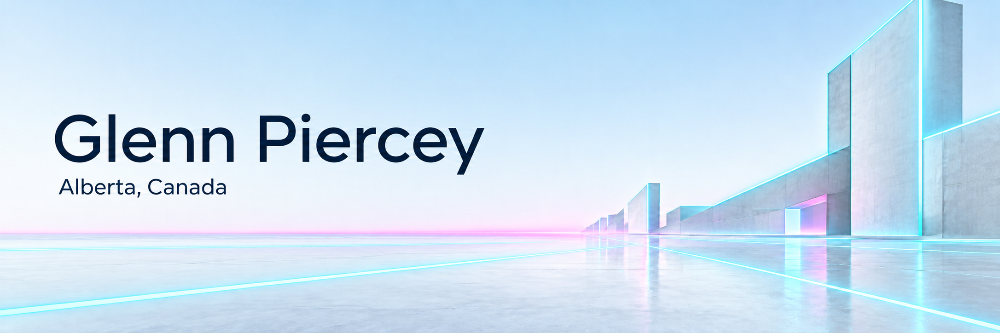

<picture>
  <source media="(prefers-color-scheme: dark)" srcset="assets/profile-synthwave.png">
  <source media="(prefers-color-scheme: light)" srcset="assets/profile-synthwave-light.png">
  
</picture>

I'm learning to code by building tools I want to use. These projects help me explore how applications work and try to solve problems I've run into with existing software.

## Currently building

**CarLog** 
A personal vehicle history tracker for mileage, fuel, repairs, and maintenance. I started it to learn coding practices and better understand how much my vehicles were costing me.

**Facility Scheduling** 
An early-stage project for scheduling municipal facilities and managing bookings. I'm building it as an alternative to existing services I've found slow, outdated, and frustrating to use.

**Notebook** 
A notebook application for Windows and the browser. I'm aiming for something between Obsidian and Notion, because neither gives me everything I want.

**Cadence** 
A workplace application in development for organizing teams, shared workspaces, and staffing.
